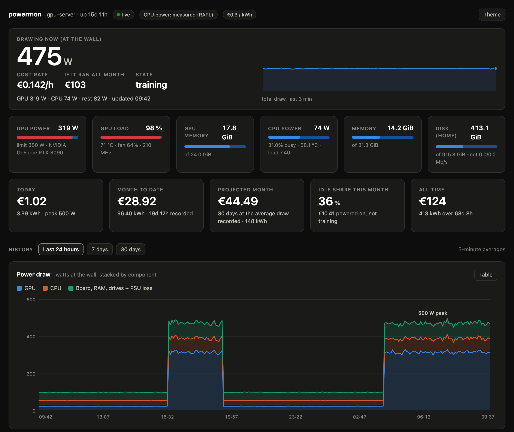

<p align="center">
  
</p>

<h1 align="center">powermon</h1>

<p align="center">
  <b>What your GPU box is drawing right now, and what it is costing you.</b><br>
  A tiny power, resource and cost monitor for Linux training machines.
</p>

<p align="center">
  <a href="#quick-start">Quick start</a> ·
  <a href="#electricity-price">Electricity price</a> ·
  <a href="#alerts">Alerts</a> ·
  <a href="#remote-access">Remote access</a> ·
  <a href="#how-accurate-is-it">Accuracy</a> ·
  <a href="#api">API</a>
</p>

<p align="center">
  
</p>

## What you get

- **Watts at the wall, live**, split into GPU, CPU and everything else.
- **Real money**: cost per hour, today, this month and projected, at a flat,
  time-of-day or live market price.
- **Idle share**: what you paid to leave the machine on while it was not
  training.
- **A push to your phone** when the machine burns power with the GPU idle.
- **Three ways to look**: a web dashboard, `pwr` in the terminal, and a macOS
  menu bar app.
- **Nothing to install**: one Python file, standard library only. It uses
  0.25 % of one core and about 35 MB of RAM, and runs at low priority so it
  never competes with a training job.

## Quick start

On the Linux machine you want to measure (Python 3.10+, systemd):

```sh
git clone https://github.com/marzmesas/powermon.git ~/powermon
~/powermon/install.sh
```

The installer creates `config.toml` with a fresh access token, starts powermon
as a systemd user service that survives logout and reboot, links `pwr` into
`~/.local/bin`, and prints the URL and token to use from other devices.

| Flag | Effect |
|---|---|
| `--local` | listen on `127.0.0.1` only, no token |
| `--rapl` | also install the udev rule for [measured CPU power](#measured-cpu-power) (needs sudo) |

Running it again never touches an existing `config.toml`.

Then:

1. **Open the dashboard** at <http://localhost:8787>, or at the URL the
   installer printed from another device.
2. **Set your [electricity price](#electricity-price)** in `config.toml`.
3. **Optionally** turn on [alerts](#alerts) and install the
   [menu bar app](macos/README.md).

It works without a GPU (the GPU panels hide themselves) and without readable
CPU energy counters (CPU power is then estimated).

### Docker

```sh
docker compose up -d
```

On first start the container writes `config.toml` into the `powermon-data`
volume and prints a generated token to the log: `docker compose logs powermon`
shows `powermon: generated access token: ...`. Set `POWERMON_TOKEN` in the
environment before `up` to choose the token yourself. Open
`http://localhost:8787/?token=YOUR_TOKEN` once to set the cookie.

Inside a container, CPU and memory come from the kernel's `/proc`, and CPU power
is estimated from utilisation unless `/sys/class/powercap` is mounted (see the
commented lines in `docker-compose.yml`); GPU readings need the NVIDIA runtime.

## Ways to look at it

| Client | What it is |
|---|---|
| **Web dashboard** | served by powermon itself; the full view, including history |
| **`pwr`** | terminal readout: `pwr` (snapshot), `pwr -w` (live), `pwr --json`. For a remote instance set `POWERMON_TOKEN` or pass `--token` |
| **macOS menu bar app** | wall watts in the menu bar, and a panel with meters, totals and GPU processes. See [`macos/`](macos/README.md) |

The dashboard shows:

- **Hero** — watts at the wall right now, cost per hour, cost if it ran all month.
- **Meters** — GPU power against its 350 W limit, GPU load / memory, CPU power,
  RAM, disk.
- **Tiles** — today, month to date, projected month, **idle share** (what you
  paid to leave it powered on and not training), all time.
- **Charts** — power draw stacked by component, kWh + cost per hour/day,
  temperatures. 24 h / 7 d / 30 d. Every chart has a table view and a tooltip;
  arrow keys move the crosshair.
- **GPU processes** — what's actually on the card.

## Configuration

The electricity price, the alerts and sleep-when-idle can be set from the
dashboard: **Settings** in the header. Changes apply at once, without a restart,
and are saved to `settings.json` next to `config.toml` (`server.settings_file`
moves it). That file overrides `config.toml` key by key and is the only file the
page ever writes, so `config.toml` and its comments are left exactly as written.
A field changed from the page shows a **reset** control, which drops the
override so the `config.toml` value applies again; deleting `settings.json`
resets everything.

Changing settings needs an admin key, or a browser on the machine itself
(addressed by IP, `localhost` or the machine's name). A `read` key sees the
values with the ntfy and webhook URLs blanked. `server.settings_writable = false`
turns the page's write access off entirely.

Some settings are deliberately file-only, because a web form that could change
them would be a bigger privilege than "change a price": `suspend.command` (it
is executed), `tariff.dynamic_url` / `dynamic_json_path` / `dynamic_headers`
and everything in `[meter]` (the daemon fetches those URLs with those headers),
`[server]` (access control itself) and `[sampling]`.

Everything else lives in `config.toml`; [`config.example.toml`](config.example.toml)
documents every key. Restart after editing it:

```sh
systemctl --user restart powermon
```

`./powermon.py --show-config` prints the effective configuration, overrides
included, with the token and secret URLs redacted.

| Section | What it controls |
|---|---|
| `[tariff]` | what a kWh costs: see [electricity price](#electricity-price) |
| `[alerts]` | the idle-draw push: see [alerts](#alerts) |
| `[server]` | address, port, token: see [remote access](#remote-access) |
| `[meter]` | a real wall meter: see [using a real meter](#using-a-real-meter) |
| `[power]`, `[cpu]` | the model's constants: see [calibrating](#calibrating-against-reality) |
| `[sampling]` | interval and how long raw samples are kept |
| `[activity]` | what counts as "training" rather than idle but powered on |

## Electricity price

`[tariff]` covers the three ways electricity is sold; pick the one on your bill.

| `mode` | Contract | You set |
|---|---|---|
| `flat` | one price all day | `rate` |
| `tou` | fixed prices by time of day | `tou_weekday`, optionally `tou_weekend` and `tou_holidays` |
| `dynamic` | the price follows the market | `dynamic_source`, and usually `dynamic_surcharge` |

A dynamic price can come from three places:

| `dynamic_source` | Covers | Needs |
|---|---|---|
| `energy-charts` | day-ahead spot prices for European bidding zones (Fraunhofer ISE, CC BY 4.0) | `dynamic_zone`, e.g. `DE-LU` |
| `pvpc` | Spain's regulated consumer price (Red Eléctrica) | nothing |
| `http` | anywhere: the current price from any JSON endpoint, such as a Home Assistant sensor from your supplier's integration | `dynamic_url`, `dynamic_json_path` |

A spot price is not what you pay: contracts add grid fees, levies and a margin
per kWh. Put that sum in `dynamic_surcharge`. `tax_pct` is then added to every
price in the section, so leave it at 0 if the figures you typed already include
tax.

Dynamic mode needs outbound HTTP(S). While a price cannot be fetched the daemon
bills at `rate` and says so in the health banner. Each hour is stored with the
price it was billed at, so changing the tariff changes what you pay from then
on, never what a past hour cost.

### Carbon

`[carbon] g_per_kwh` is the grams of CO2 emitted per kWh of the electricity you
buy. When it is set, the dashboard tiles and `/api/now` (`power.co2_g_per_h`,
`totals.*.co2_kg`), `/api/runs` and `/metrics` report CO2 beside cost. The
figure depends on the grid and on the hour, so it is a factor you supply, not
one powermon measures. Your supplier or grid operator usually publishes an
average. `0`, the default, reports no CO2 at all, because an unknown factor is
not a zero.

## Alerts

All off until you set a limit. Each alert sends one push when it trips and one
when it clears (back under for 60 s); nothing in between, so a stuck condition
cannot turn into a stream of notifications. A sensor that cannot be read neither
trips nor clears an alert.

| Alert | Keys | Trips when |
|---|---|---|
| `idle` | `idle_w`, `after_min` (10), `remind_min` (60) | wall draw is above `idle_w` watts **while the GPU is idle** for `after_min`; one urgent reminder at `remind_min` if it is still going |
| `gpu_temp` | `gpu_temp_c`, `temp_after_min` (5) | the hottest GPU is above `gpu_temp_c` for `temp_after_min` |
| `cpu_temp` | `cpu_temp_c`, `temp_after_min` (5) | the CPU is above `cpu_temp_c` for `temp_after_min` |
| `disk` | `disk_pct` | disk usage is above `disk_pct` percent, immediately |
| `budget` | `month_budget` | this calendar month's cost so far first exceeds `month_budget` (tariff currency); once per month, and a restart does not repeat it |

Pushes go to an [ntfy](https://ntfy.sh) topic: install the app, subscribe to a
long random topic name, and put its URL in `alerts.ntfy_url`. Set
`alerts.webhook_url` as well (or instead) and every alert is also sent there as
an HTTP POST with `Content-Type: application/json` and the body
`{"title", "message", "priority", "tags", "host", "kind"}`, where `kind` is the
alert column above. It is a plain JSON POST: no service-specific formatting, so
a receiver that wants its own shape needs a small adapter in between. Only
`http://` and `https://` URLs are used, and a failed delivery is logged and
dropped. Without either URL the alerts are still reported in `/api/now`
(`alert` for the idle alert, `alerts` for every active one), shown on the
dashboard, and the menu bar app's icon turns yellow.

```sh
curl -d "powermon test" https://ntfy.sh/<your-topic>     # check delivery
```

## Sleeping when idle

Off by default. Set `suspend.after_idle_min` (minutes, `0` = off) and the box
suspends itself once **all four** of these have held continuously for that long:

1. the GPU is idle,
2. CPU utilisation is below `suspend.max_cpu_pct` (20), so a CPU-only job counts as work,
3. no training run is open,
4. nobody has an interactive session (no `pts`/`tty` line in `who`; SSH sessions
   count). `suspend.skip_if_logged_in = false` drops this condition.

Any violation restarts the countdown, as does a gap of over 60 s between samples,
so a machine that has just woken is not put straight back to sleep. A low-priority
notification (kind `suspend`) goes out first, then `suspend.command` runs
(`systemctl suspend` by default). If the command fails, the error is logged and
nothing is retried for another full window. `/api/now` reports
`suspend: {enabled, in_s}` and the dashboard shows a banner during the last 10
minutes. The notification is sent in the background and may not arrive before the
machine is asleep. A negative value, or an empty command while enabled, stops the
daemon at startup.

A systemd user service may not be allowed to suspend when no one is logged in at
the console; polkit can refuse. Try `systemctl suspend` once by hand over SSH
to see whether it is permitted (the machine will sleep if it is). If it asks for
authentication or is denied, a polkit rule for `org.freedesktop.login1.suspend`
is needed.

The macOS app's Wake button sends a Wake-on-LAN packet to `meta.mac`. That needs
Wake-on-LAN enabled in firmware and in the OS (`ethtool <iface> | grep Wake-on`
should show `g`), and works only from the same local network.

## Training runs

A run is a continuous busy stretch (see `[activity]`): it starts once the GPU
has been busy for `run_min_s`, so a blip is not a run, and ends once it has been
idle for `run_gap_s`, so a pause between epochs does not split it. Each run
records its start, end, energy, cost at the price in force at the time, peak
and average draw, and the GPU process seen most often. Intervals where the GPU
could not be read add no energy. The dashboard lists the latest runs, and
`/api/runs?format=csv` exports them. A run still open when the daemon stops is
closed at its last recorded update.

To price a single command, whether or not the GPU is involved:

```sh
pwr run -- python train.py     # prints duration, kWh and cost afterwards
```

That figure is the whole machine over the command's wall-clock time, so it
includes anything else running meanwhile. The command's exit code is passed
through; if the daemon cannot be reached the command still runs and `pwr` says
the cost could not be measured.

## Remote access

The installer already sets a token and listens on every interface, so the URL
it prints works from any device that can reach the machine. With `--local`,
powermon listens on `127.0.0.1` only and you use an SSH tunnel instead.

**The rule:** clients on the machine itself (`127.0.0.1`) never need the token,
so `pwr` keeps working unconfigured. Every other client must present it, as
`?token=…`, an `X-Powermon-Token` header, or the `powermon_token` cookie. Open
the URL with `?token=…` once and the cookie is set for a year. Listening beyond
loopback without a token is refused at startup.

The token travels over **plain HTTP**: fine on a tailnet or a trusted LAN, not
something to expose to the internet.

### Tailscale (recommended)

Puts the dashboard on a private network reachable from anywhere, with nothing
exposed to the public internet:

```sh
curl -fsSL https://tailscale.com/install.sh | sh
sudo tailscale up
```

Then from your laptop or phone, both on the tailnet, open
`http://<your-server>:8787/?token=<your token>`. Add it to your phone's home
screen and it behaves like an app.

### SSH tunnel

Needs no token and nothing listening remotely, so it works with `--local`:

```sh
ssh -L 8787:127.0.0.1:8787 <user>@<your-server>
```

Then open <http://localhost:8787> on your laptop.

<details>
<summary><b>Choosing a bind address</b></summary>

| `server.host` | Who can reach it |
|---|---|
| `127.0.0.1` (what `--local` sets) | this machine only — SSH tunnel for anything else |
| your Tailscale IP | the tailnet only, not the LAN |
| `0.0.0.0` | tailnet **and** LAN (token still required) |

The token is a shared secret over **plain HTTP** — fine on a tailnet or a trusted
LAN, not something to expose to the internet. For that, put Caddy in front for
TLS and real auth.

</details>

<details>
<summary><b>Named keys: one per client, revocable</b></summary>

One shared token cannot be withdrawn from a single client. Add
keys instead, and revoke them one at a time:

```sh
./powermon.py --add-key grafana --scope read    # prints the token once
./powermon.py --add-key laptop  --scope admin
./powermon.py --revoke-key grafana
systemctl --user restart powermon               # keys load at startup
```

They are stored hashed in `server.keys_file`, so that file is not itself a
credential, and the token is shown once because it is never kept. `server.token`
still works alongside them as a one-key shorthand. Every current route is
read-only, so `admin` grants nothing extra today — it exists for the first route
that changes something.

Repeated wrong keys from one address are slowed: five free attempts, then a
delay doubling to 30 s. A correct key is never delayed, even from an address
that has been guessing, so one bad client cannot lock out the rest.

</details>

<details>
<summary><b>HTTPS</b></summary>

Set `server.tls_cert` and `server.tls_key` to serve HTTPS directly. A
self-signed certificate is fine on a tailnet:

```sh
openssl req -x509 -newkey rsa:2048 -nodes -days 825 \
  -keyout key.pem -out cert.pem -subj "/CN=$(hostname)"
```

</details>

<details>
<summary><b>Behind a reverse proxy (Caddy, nginx, Traefik)</b></summary>

Caddy, nginx and Traefik connect from this machine,
so without configuration every request they forward would look like loopback and
skip the token. Set `server.trusted_proxies` to the proxy's address and its
`X-Forwarded-For` header is used instead — from anything not listed there, the
header is ignored, so it cannot be spoofed. `server.require_token_always = true`
removes the loopback exemption entirely.

With `trusted_proxies = "127.0.0.1"` set, and powermon left on loopback:

```caddyfile
# Caddy: real certificate, powermon never exposed directly
powermon.example.com {
    reverse_proxy 127.0.0.1:8787
}
```

```nginx
# nginx: X-Forwarded-For is what powermon reads, so it must be set
location / {
    proxy_pass http://127.0.0.1:8787;
    proxy_set_header X-Forwarded-For $proxy_add_x_forwarded_for;
}
```

Caddy sets `X-Forwarded-For` by default; nginx does not, so the line above is
required. Without it every proxied request arrives as bare loopback and skips
the token.

</details>

## Several machines

Every machine keeps running its own powermon. One of them can additionally
list the others and show them together: it polls each peer's `GET /api/now`
(sending the peer's token in the `X-Powermon-Token` header) and the dashboard
gains an "All machines" card with a row per machine and a total.

```toml
[peers]
hosts = "nas=http://nas.lan:8787|abc123, lab=https://lab:8787"
poll_s = 15      # seconds between polls
timeout = 4      # per peer; a dead peer delays the others by at most this
```

Each entry is `name=URL`, optionally followed by `|TOKEN` (a read key from the
peer's `--add-key`). The peer's token is stored in this machine's `config.toml`,
so keep that file private (`--show-config` redacts it, and the Settings dialog
cannot change it). A peer that has not answered for three poll intervals shows
as unreachable with its last figures and how long ago they were read. Costs and
the cost total are only summed when every reachable machine uses the same
currency symbol; otherwise they show as unknown rather than a wrong sum.

## How accurate is it

```
wall_watts = (cpu_watts + gpu_watts + baseline_watts) / psu_efficiency
```

…unless a real meter is configured, in which case the wall figure is measured
directly and the table below only decides how it is attributed. See
[using a real meter](#using-a-real-meter).

| Component | Source | Trust |
|---|---|---|
| GPU watts | every card's own sensor, summed, via NVML (`nvidia-smi` if the library is missing); AMD cards from the `amdgpu` sysfs power file | **measured**, accurate |
| CPU watts | RAPL package energy counters, all sockets, if readable | **measured** (see below) |
| CPU watts | otherwise: utilisation curve `idle_w → max_w` | **estimated**, ±20 W |
| Baseline | configured constant (board, RAM, NVMe, fans) | assumption |
| PSU loss | configured efficiency | assumption |

So the total is a **good estimate, not a metered reading**. The GPU term — the
one that actually moves during training — is real; the constant terms are where
the error lives, and they mostly cancel out when you compare one run to another.
The dashboard states which CPU source is live in the header.

### Measured CPU power

Without it the CPU term is estimated to about ±20 W. To read the real energy
counters:

```sh
~/powermon/install.sh --rapl
```

This installs `90-rapl-readable.rules`, which makes the counters readable
without root. Read the security note in that file first. Short version: the
counters were restricted because a *very* high-frequency reader can mount a
power side-channel attack against crypto on the same machine; sampling every
2 s is orders of magnitude too slow for that. Skip it on a shared host and the
estimate stays in place.

### Using a real meter

Everything above is a model. If a UPS, smart plug or metered PDU already
measures this machine, point powermon at it and the headline number becomes a
**measurement** — the model then only decides how to split that total between
CPU, GPU and the rest.

```toml
[meter]
type = "http"
http_url = "http://plug/cm?cmnd=Status%2010"
http_json_path = "StatusSNS.ENERGY.Power"
```

| Device | `http_url` | `http_json_path` |
|---|---|---|
| Tasmota | `http://plug/cm?cmnd=Status%2010` | `StatusSNS.ENERGY.Power` |
| Shelly gen1 | `http://plug/status` | `meters.0.power` |
| Shelly gen2 | `http://plug/rpc/Switch.GetStatus?id=0` | `apower` |
| Home Assistant | `http://ha:8123/api/states/sensor.rack_power` | `state` |
| UPS via NUT | `type = "nut"` | `ups.realpower`, else load × nominal |

Home Assistant needs `http_headers = "Authorization: Bearer YOUR_TOKEN"`, which
makes any energy entity it already knows about usable here — including meters
powermon has no driver for.

`power.residual_w` then reports meter minus model, in watts. That is exactly
what `baseline_w` and `psu_efficiency` are getting wrong, so you can tune them
until it approaches zero without owning a second meter.

**One caveat:** the meter measures whatever is plugged into it. If your UPS
feeds the whole rack, powermon will report the whole rack as this machine.
Use a per-outlet reading, or a plug that only this machine is on.

If the meter stops answering, powermon falls back to the model and says so
rather than reporting a gap — `power.wall_source` flips to `model` and a
warning appears on the dashboard. A dead meter is retried occasionally rather
than on every sample, so it costs nothing while it is down.

### Calibrating against reality

If you have a plug meter (a €15 one is plenty), calibrate once and every number
below gets better:

1. Idle, nothing running. Read the meter, then `pwr`.
   Set `baseline_w = meter_watts * psu_efficiency - cpu_w - gpu_w`.
2. Under a full training load, read both again. If they still disagree, adjust
   `cpu.rapl_scale` (RAPL slightly under-reads socket draw on Zen 2) or
   `power.psu_efficiency`.

`systemctl --user restart powermon` after editing. Past costs are **not**
retroactively rewritten — each hour stores the tariff it was billed at.

### Supported hosts

Only the first row has been run on real hardware; the rest is what the code
paths imply, marked as such rather than claimed.

| Host | Wall power | Verified |
|---|---|---|
| Linux + NVIDIA + readable RAPL | measured GPU, measured CPU, modelled rest | **yes** — Ryzen 9 3900X + RTX 3090, Ubuntu 22.04 |
| Linux + NVIDIA, no RAPL | measured GPU, **estimated** CPU (±20 W), modelled rest | **yes** — same box without the udev rule |
| Linux, no GPU | estimated or measured CPU, modelled rest | **yes** — same box with `nvidia-smi` hidden |
| Any host with a `[meter]` | **measured at the wall**, model only attributes it | **yes** — against a simulated plug |
| Multi-GPU / multi-socket Linux | summed across devices | code paths tested, no such hardware to hand |
| AMD GPU (`amdgpu` driver) | read from the driver's sysfs files: power, load, memory, temperature; **not verified on hardware**, fixture-tested only | no AMD hardware to hand |
| Intel GPU | not read; treated as no GPU | not implemented |
| NVIDIA MIG | reports the physical card; per-instance not attributed | untested, no MIG card to hand |
| macOS, Windows, *BSD | not supported as a *host* (the menu bar app is a client) | — |

Python 3.10 or newer, standard library only. `nvidia-smi` is optional — NVML is
used when present and is what the daemon prefers.

Without a `[meter]`, the wall figure is an **estimate**: the GPU and CPU terms
are real sensors, but `baseline_w` and `psu_efficiency` are configured
constants. On a host with no GPU and no readable RAPL, every term is modelled.

## API

| Endpoint | Returns |
|---|---|
| `GET /api/now` | current sample, period totals, 3-minute sparklines, metadata. `gpu.*` is the host aggregate across every card; `gpu.devices[]` carries each one separately |
| `GET /api/runs?limit=50` (`&format=csv` for CSV) | training runs, newest first: `id`, `start`, `end` (null while running), `seconds`, `kwh`, `cost`, `peak_w`, `avg_w`, `name`, `running`. `/api/now` also carries the open one as `run` |
| `GET /api/peers` | this machine first, then each configured peer: `name`, `self`, `ok`, `error`, `age_s`, `url`, `total_w`, `cost_per_h`, `busy`, `today_cost`, `month_cost`, `month_kwh`, `symbol` (null while a peer has never answered); `total` sums the reachable ones, with `mixed_currency` and null cost sums when currencies differ |
| `GET /api/history?range=24h\|7d\|30d\|90d` (`&format=csv` for CSV) | time series (24 h = 5-min averages from raw samples; longer = hourly totals) |
| `GET /healthz` | the same `health` block as `/api/now`: `ok`, `last_sample_age_s`, `coverage_today`, the live CPU/GPU sources, and an `issues` list at `error` / `warn` / `info` |
| `GET /api/settings` | the settings the dashboard can change: `{"values": {section: {key: value}}, "overridden": ["tariff.rate", …], "editable": bool, "redacted": [...]}`. A `read` key gets the ntfy and webhook URLs as `""`, listed in `redacted` |
| `POST /api/settings` | partial update, e.g. `{"tariff": {"rate": 0.31}}`. Admin only; requires `Content-Type: application/json` and `X-Powermon-Write: 1`, and refuses a cross-origin `Origin`. The whole resulting configuration is validated before anything is saved; errors are `400 {"error": "..."}` naming the key. Returns the new `GET` payload |
| `DELETE /api/settings?key=tariff.rate` | drops one override so the `config.toml` value applies again. Same rules as `POST` |
| `GET /metrics` | the figures from `/api/now` in Prometheus text format. Needs the token like `/api/*`, except from loopback (see below) |

Prometheus cannot send custom headers, so this documents scraping from the same
machine over loopback, which needs no token:

```yaml
scrape_configs:
  - job_name: powermon
    metrics_path: /metrics
    static_configs:
      - targets: ["127.0.0.1:8787"]
```

Useful for logging a run's energy cost from a training script:

```python
import urllib.request, json
def wall_watts():
    with urllib.request.urlopen("http://127.0.0.1:8787/api/now") as r:
        return json.load(r)["power"]["total_w"]

# or bracket a run and diff all-time kWh:
def kwh():
    with urllib.request.urlopen("http://127.0.0.1:8787/api/now") as r:
        return json.load(r)["totals"]["all"]["kwh"]
```

### Home Assistant and MQTT

powermon can publish its readings to an MQTT broker, so Home Assistant (or anything else on the broker) can use them. It is off until `host` is set:

```toml
[mqtt]
host = "broker.lan"
port = 1883           # 8883 with tls = true
username = ""
password = ""
tls = false
topic = "powermon"
discovery_prefix = "homeassistant"
interval_s = 30
```

Topics, with `<host>` the hostname reduced to `A-Za-z0-9_-`:

- `<topic>/<host>/availability`: `online` (retained); the broker sets `offline` if powermon disappears.
- `<topic>/<host>/state`: one JSON object every `interval_s`, not retained. A value that is unknown (a GPU that cannot be read, say) is left out, so Home Assistant shows "unknown" instead of 0.
- `<discovery_prefix>/sensor/<host>/<name>/config` (and `binary_sensor` for busy and alert): retained discovery documents, sent each time powermon connects.

Home Assistant then lists one device, "powermon `<host>`", with sensors for power, CPU and GPU power, energy, total cost, cost per hour, cost today and this month, CPU and GPU temperature and GPU utilisation, plus busy and alert. Add the **Energy** sensor (kWh, all-time total) to the Energy dashboard as the consumption source. The currency of the cost sensors is read when powermon connects, so restart it after changing the tariff currency.

This section is not editable from the Settings dialog, and `--show-config` hides the password. If the broker is down, powermon retries in the background (5 s, doubling to 5 min) and `/api/now` `health` carries a `mqtt_disconnected` warning meanwhile. There is no QoS 1/2 and no subscribing. This has been tested against a simulated broker only, not a real one or a real Home Assistant.

## Reference

<details>
<summary><b>Storage, and why history is never rewritten</b></summary>

Two tables in `powermon.db`:

- `samples` — every 2 s reading, pruned after `raw_retention_days` (7 → ~30 MB).
- `hourly` — Wh, cost, busy/idle split, peak watts per hour. **Kept forever**,
  about 1 MB per year. This is what the long-range views and lifetime totals
  read, so deleting raw samples never loses your cost history.

Energy is integrated with the actual gap between samples, and gaps longer than
`gap_max_s` (60 s) are skipped — so time when the service was down is not
silently billed as if the machine had been drawing its last known power.

**Editing your tariff does not rewrite history.** Each hour stores the energy
rate it was billed at, and each day stores the standing charge in effect that
day, in a third `days` table. Changing `config.toml` changes what you pay from
then on, not what a closed day already cost. Today, month and all time apply the
same rule — the charge for every day actually recorded — so "all time" now means
all electricity, which it previously did not. Days the service was not running
are not charged, matching `hours` being recorded rather than elapsed time.
`cost` is split into `energy_cost` and `standing_cost` in the API. Standing
charges accrue from this version onward; days recorded before it have no stored
charge and contribute nothing.

**Sensor failures reduce coverage, never consumption.** If a GPU read fails —
a driver hiccup, a timeout — that interval contributes no energy at all and is
recorded as missing time in `secs_missing` instead. The sample stores NULL
rather than 0 W, so history shows a gap instead of a dip, and `/api/now`
reports `power.partial` for the live reading plus a `coverage` figure on every
totals period. A silently cheaper month would be worse than a visible hole. A
machine with no GPU is not a failure: that is a known zero and is billed
normally.

</details>

<details>
<summary><b>Operating the service</b></summary>

```sh
systemctl --user status powermon
systemctl --user restart powermon
journalctl --user -u powermon -f
```

The sampler catches per-sample failures and keeps running: an `nvidia-smi`
hiccup records the GPU as unavailable for that sample instead of killing the
service, and systemd restarts the process if it ever does die.

</details>

<details>
<summary><b>Files in this repository</b></summary>

| File | |
|---|---|
| `powermon.py` | sampler + HTTP API + static server — standard library only, no pip installs (running on system `/usr/bin/python3` 3.10, so conda envs can't break it) |
| `dashboard.html` | the UI, self-contained, no external requests |
| `pwr` | terminal client (symlinked into `~/.local/bin`) |
| `config.toml` | all settings |
| `90-rapl-readable.rules` | optional udev rule for measured CPU power |
| `tests/` | regression tests — `python3 -m unittest discover -s tests`, standard library only |
| `CHANGELOG.md` | what changed per release |
| `CONTRIBUTING.md` | how to run the tests, and the two constraints to know first |
| `LICENSE` | MIT |
| `dev.py` | serves the local `dashboard.html` against a running powermon and reloads on save, for working on the UI |
| `install.sh` | sets all of this up as a systemd user service |
| `Dockerfile` | container image: `python:3.12-slim`, no pip installs |
| `docker-compose.yml` | one-service compose setup with a data volume, see [Docker](#docker) |
| `systemd/powermon.service` | unit, installed to `~/.config/systemd/user/` |

</details>

## License

[MIT](LICENSE). See [CONTRIBUTING.md](CONTRIBUTING.md) for running the tests
and [CHANGELOG.md](CHANGELOG.md) for what changed.
